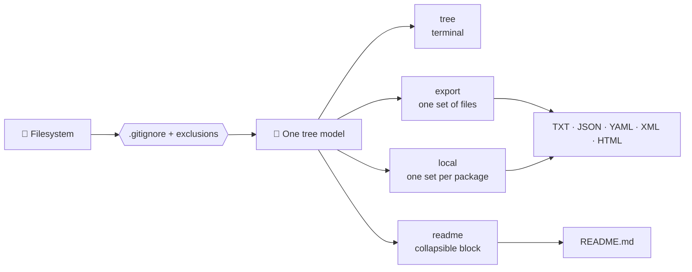

<div align="center">

# 🌳 py-structure-tools

**Your project's structure, one command away.**

Print, export and keep up to date the directory tree of any repository.<br>
`.gitignore`-aware · 5 output formats · one structure file per package · zero dependencies.

[Quick start](#-quick-start) ·
[Local structures](#-local-structures) ·
[README injection](#-readme-injection) ·
[Formats](#-output-formats) ·
[Configuration](#%EF%B8%8F-configuration) ·
[FAQ](#-faq)

</div>

---

## 🎯 What is it?

Every project needs a map: for newcomers, for code reviews, for documentation,
for AI assistants. Drawing it by hand is slow, and it is outdated the day after.

`py-structure-tools` is a small Python CLI that **generates that map from your
actual files**. It respects your `.gitignore`, skips the usual noise
(`__pycache__`, `.venv`, `node_modules`…) and writes the result wherever you need
it:

- in your **terminal**,
- in **files** (TXT, JSON, YAML, XML, interactive HTML),
- in **every Python package**, as a local structure file,
- directly **inside your README**, as a collapsible tree.

It has **no runtime dependency**: only the Python standard library.

---

## 🚀 Quick start

```bash
pip install git+https://gitlab.com/dev-tools-cr/python/py-structure-tools.git
pystructure tree
```

That's it. Requires **Python 3.11+** and works on Windows, macOS and Linux.

<details>
<summary>Other ways to install</summary>

```bash
# pipx: isolated global command
pipx install git+https://gitlab.com/dev-tools-cr/python/py-structure-tools.git

# uv: run without installing
uvx --from git+https://gitlab.com/dev-tools-cr/python/py-structure-tools.git pystructure tree
```

With **Pixi**, add the package to another project as a PyPI Git dependency:

```toml
[pypi-dependencies]
py-structure-tools = { git = "https://gitlab.com/dev-tools-cr/python/py-structure-tools.git" }
```

```bash
pixi update
```

</details>

### The four commands

```bash
pystructure tree     # print the tree in your terminal
pystructure export   # write the tree to one or more files
pystructure local    # write a structure file in every package
pystructure readme   # inject the tree inside your README
```

Run `pystructure <command> --help` for the options of each command.

---

## ✨ See it in action

Running `pystructure tree` on this very repository gives the tree below.
It was generated by the tool itself and injected here with `pystructure readme`.

<details open>
<summary><b>📂 Live output: this tool's own structure</b></summary>

<!-- pystructure:start -->
<ul>
<li>
<details open>
<summary>📂 <b>py-structure-tools</b> <sub>7</sub></summary>
<ul>
<li>
<details open>
<summary>📂 <b>src</b> <sub>1</sub></summary>
<ul>
<li>
<details>
<summary>📁 <b>py_structure_tools</b> <sub>11</sub></summary>
<ul>
<li>
<details>
<summary>📁 <b>renderers</b> <sub>7</sub></summary>
<ul>
<li>📄 __init__.py</li>
<li>📄 html.py</li>
<li>📄 json.py</li>
<li>📄 md.py</li>
<li>📄 txt.py</li>
<li>📄 xml.py</li>
<li>📄 yaml.py</li>
</ul>
</details>
</li>
<li>📄 __init__.py</li>
<li>📄 builder.py</li>
<li>📄 cli.py</li>
<li>📄 config.py</li>
<li>📄 defaults.py</li>
<li>📄 gitignore.py</li>
<li>📄 local.py</li>
<li>📄 model.py</li>
<li>📄 printer.py</li>
<li>📄 stats.py</li>
</ul>
</details>
</li>
</ul>
</details>
</li>
<li>
<details open>
<summary>📂 <b>tests</b> <sub>10</sub></summary>
<ul>
<li>📄 test_builder.py</li>
<li>📄 test_cli.py</li>
<li>📄 test_config.py</li>
<li>📄 test_gitignore.py</li>
<li>📄 test_json_roundtrip.py</li>
<li>📄 test_local.py</li>
<li>📄 test_model.py</li>
<li>📄 test_readme.py</li>
<li>📄 test_renderers.py</li>
<li>📄 test_stats.py</li>
</ul>
</details>
</li>
<li>📄 LICENSE</li>
<li>📄 pixi.lock</li>
<li>📄 pixi.toml</li>
<li>📄 pyproject.toml</li>
<li>📄 README.md</li>
</ul>
</details>
</li>
</ul>
<!-- pystructure:end -->

</details>

Prefer something clickable? `pystructure export --formats html` produces a
**standalone interactive tree**: folders open and close, with _Open all_ and
_Close all_ buttons, and no JavaScript framework.

---

## 💡 Why you'll like it

|                           |                                                                                      |
| ------------------------- | ------------------------------------------------------------------------------------ |
| 🧹 **Clean by default**   | Respects `.gitignore`, skips `__pycache__`, `.venv`, `node_modules`…                 |
| 📦 **5 formats, 1 model** | TXT, JSON, YAML, XML and HTML are rendered from the same tree, so they always agree. |
| 📍 **Local structures**   | One command writes a structure file at the root and in every package.                |
| 📝 **README-ready**       | Keep a collapsible tree up to date inside your README, between two markers.          |
| 🤖 **LLM-friendly**       | Give an assistant a compact map of one package instead of the whole repo.            |
| 📊 **Metadata**           | Optional file sizes, dates and a summary (counts, total size, extensions).           |
| ✅ **CI-ready**           | `--check` exits with code 1 when a structure is outdated.                            |
| 🪶 **Zero dependency**    | Pure standard library, including `.gitignore` matching and the YAML writer.          |

---

## 🧭 How it works



The tree is built **once**, then rendered by every command. That is why all
outputs stay consistent.

---

## 🖥️ Usage

### Print a tree

```bash
pystructure tree                                  # current directory
pystructure tree --root path/to/project           # another directory
pystructure tree --max-depth 3                    # limit depth
pystructure tree --include-hidden                 # show dotfiles
pystructure tree --no-gitignore                   # ignore .gitignore rules
pystructure tree --exclude-dir sandbox --exclude-dir docs
pystructure tree --exclude-file "*.log" --exclude-file "*.tmp"
```

### Export a tree

```bash
pystructure export                                # formats from configuration
pystructure export --formats all                  # txt json yaml xml html
pystructure export --formats txt html             # selected formats
pystructure export --formats txt --output-dir docs
pystructure export --formats all --basename structure_repo
pystructure export --formats html --open-depth 2  # HTML: folders open by default
```

Options can be combined with the common ones (`--root`, `--max-depth`,
`--exclude-dir`…). Existing files are overwritten.

### Add sizes, dates and a summary

```bash
pystructure tree --size                  # file sizes (B, KB, MB...)
pystructure tree --dates                 # modification and creation dates (UTC)
pystructure tree --summary               # counts, total size, extensions
pystructure tree --size --dates --summary
pystructure export --formats all --size --dates --summary
```

Sizes and dates are carried by the `txt`, `json`, `yaml`, `xml` and `html`
exports. The summary is appended to the `tree` output and to the `txt` export.
Directories that cannot be read are flagged with an error instead of stopping
the scan.

### Reuse a JSON export

A JSON export can be rendered again **without scanning the disk**:

```bash
pystructure export --from-json structure_repo.json --formats txt html --basename out
pystructure tree --from-json structure_repo.json --summary
```

`--from-json` is available on `tree` and `export`. An invalid file produces a
clear error message, not a traceback.

---

## 📍 Local structures

Large projects are easier to understand one package at a time. `local` builds the
full tree **once**, then writes a structure file in every relevant folder. Each
file describes **its own folder and everything below it**.

```bash
pystructure local                           # root + every folder with __init__.py
pystructure local --mode all                # root + every non-empty folder
pystructure local --formats txt json html   # several formats at once
pystructure local --max-depth 2             # depth relative to each generated file
pystructure local --dry-run                 # preview, writes nothing
pystructure local --check                   # exit code 1 if anything is outdated
```

<details>
<summary><b>What does the result look like?</b></summary>

```text
my-project
├── structure_repo.txt              ← whole project
└── src
    └── my_package
        ├── __init__.py
        ├── structure_repo.txt      ← this package only
        └── api
            ├── __init__.py
            └── structure_repo.txt  ← this sub-package only
```

</details>

- Files are **only rewritten when their content changes**: running the command
  twice produces no Git diff.
- Generated files **never appear in the structures they describe**.
- Every format is supported, including JSON, YAML, XML and HTML.

---

## 📝 README injection

`readme` keeps a **collapsible, clickable tree** up to date inside any Markdown
file. It only replaces what sits between two markers, and never touches the rest.

**1. Add the markers once** (with a blank line before and after):

```markdown
<!-- pystructure:start -->
<!-- pystructure:end -->
```

**2. Generate the tree:**

```bash
pystructure readme                          # updates README.md
pystructure readme --max-depth 4            # limit the depth of the tree
pystructure readme --open-depth 2           # folders open by default
pystructure readme --file docs/OVERVIEW.md  # another Markdown file
pystructure readme --check                  # exit code 1 if outdated
```

> GitLab and GitHub filter CSS and JavaScript in Markdown, so the injected block
> uses plain `<details>` and emojis. For the full dark-theme page with its
> buttons, use `pystructure export --formats html`.

---

## 🔁 Keep everything up to date

### pre-commit

```yaml
# .pre-commit-config.yaml
repos:
  - repo: local
    hooks:
      - id: pystructure-local
        name: Check local structures
        entry: pystructure local --check
        language: system
        pass_filenames: false
      - id: pystructure-readme
        name: Check README structure
        entry: pystructure readme --check
        language: system
        pass_filenames: false
```

### GitLab CI

```yaml
# .gitlab-ci.yml
structure-check:
  image: python:3.13 # the full image includes git, needed by pip
  script:
    - pip install git+https://gitlab.com/dev-tools-cr/python/py-structure-tools.git
    - pystructure local --check
    - pystructure readme --check
```

Use the **same options** (`--max-depth`, `--exclude-dir`…) in the check as in the
generation, otherwise the comparison will report a difference.

---

## 📦 Output formats

| Format | Extension | Description                                                    |
| ------ | --------- | -------------------------------------------------------------- |
| TXT    | `.txt`    | Plain Unicode tree.                                            |
| JSON   | `.json`   | Structured, machine-readable tree.                             |
| YAML   | `.yaml`   | Human-readable structured tree, without PyYAML.                |
| XML    | `.xml`    | XML tree representation.                                       |
| HTML   | `.html`   | Standalone interactive tree using `<details>` and `<summary>`. |

With `--basename structure_repo`, the generated files are `structure_repo.txt`, `.json`, `.yaml`, `.xml` and `.html`.

JSON is also an **input**: `--from-json` rebuilds the tree from a previous JSON export, so you can re-render it in any other format.

---

## ⚙️ Configuration

Set your defaults once in the target project's `pyproject.toml`:

```toml
[tool.py-structure-tools]
exclude_dirs = ["sandbox", "litterature", "docs", "site"]
exclude_files = ["*.log", "*.tmp"]
include_hidden = false
use_gitignore = true
max_depth = 5
default_formats = ["txt", "html"]
output_basename = "structure_repo"
show_size = true
show_dates = false
show_summary = true
```

| Option            | Type           | Default            | Description                                                       |
| ----------------- | -------------- | ------------------ | ----------------------------------------------------------------- |
| `exclude_dirs`    | `list[str]`    | Built-in defaults  | Directory names to exclude.                                       |
| `exclude_files`   | `list[str]`    | Built-in defaults  | File glob patterns to exclude.                                    |
| `include_hidden`  | `bool`         | `false`            | Include paths starting with `.`.                                  |
| `use_gitignore`   | `bool`         | `true`             | Apply root `.gitignore` patterns.                                 |
| `max_depth`       | `int` or unset | unset              | Maximum depth to traverse.                                        |
| `default_formats` | `list[str]`    | `["txt"]`          | Formats used by `export` and `local` when `--formats` is omitted. |
| `output_basename` | `str`          | `"structure_repo"` | Basename of generated files.                                      |
| `show_size`       | `bool`         | `false`            | Collect and display file sizes.                                   |
| `show_dates`      | `bool`         | `false`            | Collect and display modification and creation dates.              |
| `show_summary`    | `bool`         | `false`            | Append a summary to the `tree` output and the TXT export.         |

CLI options are merged with the configuration: exclusions are combined, the `--size`, `--dates` and `--summary` flags turn the matching option on, and explicit values such as `--max-depth` take precedence.


<details>
<summary><b>Default exclusions</b></summary>

Directories:

```text
.git  .hg  .svn  .pixi  .venv  venv  __pycache__  .pytest_cache
.ruff_cache  .mypy_cache  .tox  node_modules  __pypackages__
```

Files:

```text
*.pyc  *.pyo  *.pyd  .coverage  coverage.xml
```

Project-specific folders such as `docs`, `site` or `sandbox` belong in your
`pyproject.toml`, not in global defaults.

</details>

---

## 📚 CLI reference

<details>
<summary><b>All options</b></summary>

```text
pystructure tree   [OPTIONS]
pystructure export [OPTIONS]
pystructure local  [OPTIONS]
pystructure readme [OPTIONS]
```

Common options (all commands):

```text
--root PATH               Root directory (default: current directory)
--max-depth INT           Maximum tree depth
--include-hidden          Include files and folders starting with '.'
--no-gitignore            Do not apply .gitignore patterns
--exclude-dir NAME        Directory name to exclude (repeatable)
--exclude-file PATTERN    File glob pattern to exclude (repeatable)
--size                    Collect and display file sizes
--dates                   Collect and display modification/creation dates (UTC)
--summary                 Append a summary (counts, total size, extensions) to TXT output
```

`tree` options:

```text
--from-json PATH          Load the tree from a JSON export instead of scanning the disk
```

Global option:

```text
--version                 Print the version and exit
```

`export` options:

```text
--from-json PATH          Load the tree from a JSON export instead of scanning the disk
--output-dir PATH         Where output files are written (default: root)
--basename NAME           Output basename
--formats FORMAT [...]    txt json yaml xml html all
--open-depth INT          HTML only: folders open by default up to this depth
```

`local` options:

```text
--mode {init,all}         init: root + folders with __init__.py (default)
                          all: root + every non-empty folder
--basename NAME           Output basename
--formats FORMAT [...]    txt json yaml xml html all
--open-depth INT          HTML only: folders open by default up to this depth
--dry-run                 Show what would change, write nothing
--check                   Write nothing, exit 1 if anything is outdated
```

With `local`, `--max-depth` is relative to each generated file.

`readme` options:

```text
--file PATH               Markdown file to update (default: README.md, relative to --root)
--open-depth INT          Folders open by default up to this depth (default: 1)
--check                   Write nothing, exit 1 if the file is outdated
```

</details>

---

## ❓ FAQ

<details>
<summary><b>How do I generate a directory tree of a Python project?</b></summary>

Install `py-structure-tools` and run `pystructure tree`. The tree respects your
`.gitignore` and skips cache folders automatically.

</details>

<details>
<summary><b>How do I export a project structure to JSON, YAML, XML or HTML?</b></summary>

Run `pystructure export --formats json yaml xml html`, or `--formats all` for
every supported format.

</details>

<details>
<summary><b>How do I give my project structure to an LLM or AI assistant?</b></summary>

Export a TXT or JSON structure with `pystructure export --formats txt`, or run
`pystructure local` to create a small structure file per package. Local files are
much lighter than a full tree and give an assistant precise context.

</details>

<details>
<summary><b>How do I keep a project structure file up to date automatically?</b></summary>

Use `pystructure local` to regenerate files (only changed files are rewritten),
and `pystructure local --check` in a pre-commit hook or CI job to fail when a
file is outdated.

</details>

<details>

<details>
<summary><b>How do I show file sizes and a summary in my project tree?</b></summary>

Run `pystructure tree --size --summary`. Add `--dates` for modification and
creation dates. To make it the default, set `show_size = true` and
`show_summary = true` in your `pyproject.toml`.

</details>

<details>
<summary><b>Can I re-render a tree without scanning the project again?</b></summary>

Yes. Export once to JSON, then run
`pystructure export --from-json structure_repo.json --formats html`.

</details>

<summary><b>How do I show my project tree in my README?</b></summary>

Add the `<!-- pystructure:start -->` and `<!-- pystructure:end -->` markers to
your README, then run `pystructure readme`. Run it again whenever the structure
changes, or check it in CI with `pystructure readme --check`.

</details>

<details>
<summary><b>Does it need any third-party package?</b></summary>

No. It only uses the Python standard library, including `.gitignore` matching
and YAML output.

</details>

<details>
<summary><b>Which Python versions are supported?</b></summary>

Python 3.11 and later (3.11, 3.12 and 3.13 are declared in the package).

</details>

---

## 🛠️ Development

This repository uses [Pixi](https://pixi.sh) with two environments: `default`
(run the tool) and `dev` (format, lint, type-check, test).

```bash
pixi install --all             # create both environments

pixi run structure             # regenerate this repo's local structures
pixi run structure-size        # print the tree with sizes and a summary
pixi run structure-dates       # same, with modification and creation dates
pixi run readme                # refresh the tree injected in this README

pixi run -e dev fmt            # format
pixi run -e dev lint           # lint
pixi run -e dev typecheck      # type check
pixi run -e dev tests          # run tests
pixi run -e dev check          # fmt + lint + typecheck + tests
pixi run -e dev ci             # same checks, without modifying files
```

### Versioning

Versions follow the date format `YYYY.M.D` (for example `2026.10.21`), with no
leading zero. A second release on the same day appends a segment: `2026.10.21.1`.
The version lives only in `pyproject.toml` and is exposed as
`py_structure_tools.__version__` and `pystructure --version`.


---

## 🧱 Design principles

- **Zero runtime dependency**: only the Python standard library.
- **Single traversal engine**: terminal output and exports share one tree model.
- **Predictable exclusions**: defaults, configuration and CLI options combine clearly.
- **Portable output**: generated files can be committed, shared or attached to reviews.
- **Strict quality**: linting, strict typing and tests are part of the workflow.

---

## 📄 License

Copyright (c) 2026 Clement RACINET

Distributed under the X11 License with an additional no-endorsement clause.
See [`LICENSE`](LICENSE) for details.
